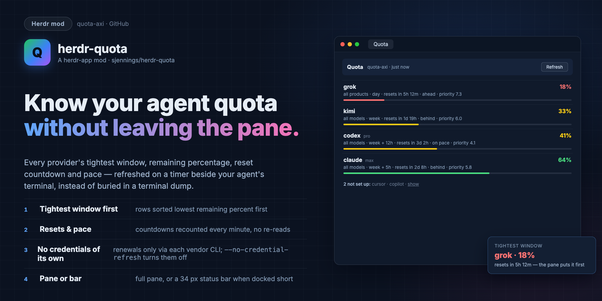
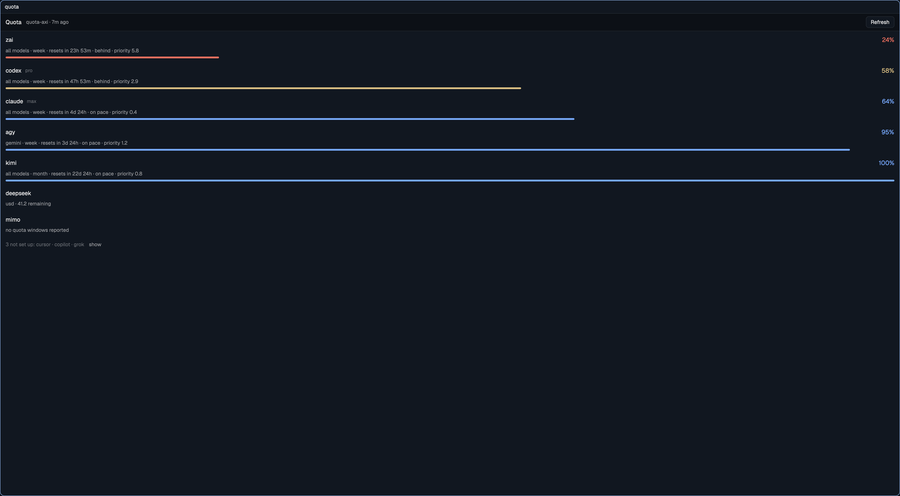

# herdr-quota

Watch local provider quota windows in a herdr-app pane instead of a
terminal dump.





quota-axi runs as usual — same CLI, same readings, same output for the
agent. Only the surface changes: the report opens as a native pane beside
the agent's terminal and refreshes itself. Each provider shows its
tightest window, remaining %, reset time and pace; providers that are not
set up or whose credentials expired are shown plainly, folded into one
line until you expand them.

## What is quota-axi?

[quota-axi](https://github.com/kunchenguid/quota-axi) ([npm](https://www.npmjs.com/package/quota-axi))
is a command-line tool that reports how much quota you have left with local
AI coding agents — Claude, Codex, Cursor, GitHub Copilot, Grok, Kimi, Z.AI,
Alibaba, Antigravity, DeepSeek, OpenRouter and others. It reads your local
auth sources and asks each vendor's own endpoints for the remaining quota
windows, when they reset, and the pace you're burning through them. It never
routes requests or logs you in, and it mints no credentials of its own. By
default, though, it may ask a vendor's own CLI to refresh an expired
session; `--no-credential-refresh` turns that off. This plugin puts that
report in a herdr-app pane instead of a terminal dump.

## Install

Needs herdr-app, quota-axi on `PATH` (`quota-axi --help` works) and `jq`.

```sh
git clone https://github.com/sjennings/herdr-quota
cd herdr-quota && ./install.sh
```

This links three things to this checkout:

- `mods/quota/` as the herdr mod `quota` (`~/.config/herdr-app/mods/quota`)
- `bin/quota-herdr` into `~/.local/bin`
- `skill/quota-herdr` into `~/.claude/skills`, so agents know the command

## Use

Ask the agent for quota status "in herdr", or run it yourself:

```sh
quota-herdr                 # opens (or splits) the Quota pane
quota-herdr --json          # any quota-axi arguments pass straight through
quota-herdr --provider claude
```

With no herdr window, no-argument `quota-herdr` prints the plain
quota-axi table and says so on stderr. Set `QUOTA_HERDR_PLACE` to `down`
or `tab` to open the pane there instead of on the right.

The pane also works as a compact status bar: the same mod renders a
one-line bar of the tightest providers when its block is docked short
(56 px or less). To keep one in your layout, clone the layout you use and
add a block such as
`{ "id": "quota", "type": "block", "size": { "px": 34 }, "content": { "mod": "quota" } }`,
or open it as a pane and drag it where you want. Clicking the bar opens
the full pane in a tab.

A companion status-bar mod, which shows each provider's 5-hour window as
chips with a hover card, lives at
[AshMcConnell/herdr-quota-status](https://github.com/AshMcConnell/herdr-quota-status).

## What you see

| State | In the pane |
| --- | --- |
| Live provider | name, plan, tightest scope and its limiting window(s), remaining % with a colored bar (green ≥ 60, yellow ≥ 30, red below), "resets in …", pace, spend priority |
| Stale / credential expired | the same, plus a `stale` badge and the error with its remedy (`run kimi to refresh`) |
| Credits-only provider (e.g. DeepSeek) | `usd · 29.36 remaining` |
| Not set up / signed out | one folded line — "13 not set up: cursor · copilot · …" — with `show` to list each reason |

The header shows how old the reading is; **Refresh** forces a fresh
quota-axi read.

## How it behaves

- The pane polls `quota-axi --json` every 5 minutes and recounts reset
  countdowns every minute. Polls pass `--max-age 4m` so quota-axi can
  reuse its last reading instead of re-asking every vendor.
- Every read runs with `--no-credential-refresh`: the pane only ever
  reads quota state. It never mints, renews or delegates credentials —
  expired providers are reported as expired, plainly.
- The pane finds quota-axi on `PATH` or, when the app's environment
  lacks version managers, at the usual install paths (mise shims,
  `~/.local/bin`, Homebrew).
- With `--provider` lanes, accounts, pace and priority, quota-axi itself
  stays the source of truth: `quota-herdr <args>` gives you its full
  output unchanged.

## Develop

```sh
bun test                      # model: parsing, tightest-window, formatting
sh tests/launcher.test.sh     # launcher: pane/tab/fallback decisions
herdr-app check mods/quota    # after every mod change
```

To try install.sh without touching your real setup:

```sh
tmp=$(mktemp -d)
HOME="$tmp" HERDR_APP_HOME="$tmp/.config/herdr-app" ./install.sh
```

## Uninstall

Remove the three links (none of your data is kept elsewhere):

```sh
rm -f ~/.config/herdr-app/mods/quota ~/.local/bin/quota-herdr ~/.claude/skills/quota-herdr
```

MIT licensed — see [LICENSE](LICENSE).
