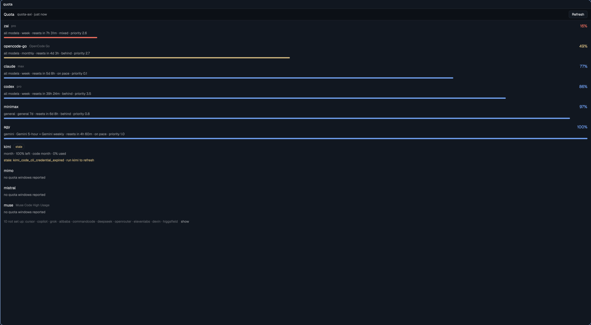

# Quota

Local provider quota windows (quota-axi) in a pane
beside your agent instead of a terminal dump. Every provider's tightest
window, remaining %, reset countdown and pace, refreshed on a timer;
not-set-up and credential-expired providers shown plainly, folded into
one line. quota-axi itself is untouched: the pane only reads it, and
`quota-herdr <args>` still passes any argument through.

## What you see

A pane (or tab) named `Quota`, opened beside the terminal that started
it — or a 34 px bar when the same mod is docked short in a layout.

- **Header**, 40 px, `chrome` background. "Quota" in 13 px semibold, then
  "quota-axi · 4m ago" in 11.5 px `muted` (the reading's age, recounted
  every minute). On the right a **Refresh** button (26 px, `surface`
  background, `border` outline) that forces a fresh read; while a read
  is in flight it dims and reads "Reading…".
- **Provider rows**, tightest first. Row one: provider name in 13 px
  semibold, plan in 11 px `dim` (`max`, `pro`), an optional `stale` badge
  (10.5 px, yellow `ansi3`), and on the right the remaining percentage in
  14 px semibold — green (`done`) at 60 % and up, yellow (`ansi3`) at
  30–59 %, red (`blocked`) below 30 %. Row two, 11.5 px `muted`, one
  truncated line: `all models · week + 5h · resets in 2d 8h · behind ·
  priority 5.8`. Row three: a 4 px bar of the same color, the fill's
  width set in `%`. Stale providers add a yellow line with the raw error
  and its remedy: `stale: kimi_code_cli_credential_expired · run kimi to
  refresh`.
- **Nothing quantified**: a credits-only provider shows
  `usd · 29.36 remaining`; a provider with windows but no verdict lists
  them (`month · 100% left`); one with neither says
  `no quota windows reported`.
- **Not set up**: one folded line, 11.5 px `dim` —
  `13 not set up: cursor · copilot · grok · …` — with a `show` link that
  lists each provider and its reason (`cursor — Cursor sign-in required`).
- **Bar mode** (block ≤ 56 px tall): one 11.5 px row of chips
  `name 32%` in each provider's tone color, six worst first, then
  `+N`, `· N off` and the reading's age in `dim`. The row's tooltip is
  "Open the quota pane"; clicking opens the full pane as a tab.
- **quota-axi missing or failed**: a centered message in `blocked`
  (`quota-axi is not installed (or not on PATH). Install quota-axi, then
  reopen this pane.`), or the program's last stderr line.

## How it behaves

- `quota-herdr` with no arguments opens the pane: split right of the
  agent's terminal (`HC_TERMINAL_ID`) in `herdr-app ls`, else a tab
  named Quota. `QUOTA_HERDR_PLACE` picks `right` (default), `down` or
  `tab`. With no herdr window it prints the plain quota-axi table and
  says so on stderr; without quota-axi it exits nonzero.
- `quota-herdr <args>` runs `quota-axi` with the arguments unchanged —
  `--json`, `--provider claude`, the TUI, everything.
- The pane polls `quota-axi --json --no-credential-refresh --max-age 4m`
  every 5 minutes; **Refresh** omits `--max-age` for one forced read.
  Countdown lines and the age label recount every minute without
  re-reading. `--no-credential-refresh` is on every read: the pane never
  mints, renews or delegates credentials.
- Rows sort by the tightest known `effectivePercentRemaining` ascending
  (providers without a number keep quota-axi's order, by name). A tie
  prefers the `all_models` scope. `limitingWindowIds` resolve to their
  windows for labels and the earliest reset; an id quota-axi no longer
  lists still shows (as its own id), never silently dropped.

## Built from

- **Mod** `mods/quota/`, `mod.json` `{ "place": "none" }`: it appears
  only where the launcher or a layout puts it. No props.
  - `main.js`: the `View`. `init` starts the first read and two
    `cx.timer`s (5 min fetch, 1 min recount); `render` picks bar or full
    layout from `on_size_change`'s height. `exec` from `herdr` runs
    quota-axi — resolved by trying `PATH` first, then
    `~/.local/share/mise/shims/quota-axi`, `~/.local/bin/quota-axi` and
    the Homebrew prefixes, because the app's own environment often lacks
    version managers (a started quota-axi that exits nonzero is a real
    error, not a reason to try the next path). JSON parse and error text
    land in one `state` machine (`loading` / `ready` / `error`).
  - `model.js`: pure. `summarize(report, now)` → active rows (name, plan,
    status, `tightest`, windows, credits, error, remedy) and the folded
    unavailable list; `pickTightest`, `formatReset`, `formatAge`,
    `remainingTone`, `paceText`/`paceTone`, `scopeLabel`, `barMode`.
    No herdr imports, so `tests/model.test.js` runs under plain `bun test`.
- **herdr**: `theme`, `exec`, `run("tab.new", …)`, `cx.timer.every`,
  `cx.spawn`, `on_size_change`, `overflow_y_scrollbar`.
- **Launcher** `bin/quota-herdr` (POSIX sh, needs `jq`):
  `herdr-app status`, `herdr-app ls`, `herdr-app do pane.split|tab.new
  --mod quota`. Argument pass-through `exec quota-axi "$@"`.
- **Skill** `skill/quota-herdr/SKILL.md`: tells agents when to run
  `quota-herdr` and that any quota-axi arguments pass through.
- **install.sh**: three symlinks (mod, launcher, skill) + `herdr-app
  check`. `tests/launcher.test.sh` drives the launcher against stub
  binaries; `tests/fixtures/quota-fixture.json` is a trimmed real
  `--json` report.

## Watch out

- The mod runs one program (`quota-axi`) on a timer and reads nothing
  else; it never refreshes credentials, and `--max-age` keeps the poll
  cheap. A read that fails leaves the last good reading on screen with
  its age climbing.
- `herdr-app check` proves load and first render only — `exec` runs, but
  nothing async is awaited. Prove a real read by opening the pane. A mod
  pane's copy also only starts once its tab is actually shown; a tab
  created in a background space runs nothing until selected.
- The app's `exec` PATH can miss version managers (mise): plain
  `exec("quota-axi")` fails even where a terminal finds it. The
  candidate list covers the common installs; an exotic one needs its
  path added (or a symlink into `~/.local/bin`).
- `w("77%")` needs the parent laid out first; before the first
  `on_size_change` the pane assumes full mode and bars simply haven't
  sized yet.
- quota-axi's JSON is schemaVersion 5. The model tolerates unknown
  statuses (they read as unavailable) and missing fields, but a future
  major schema change would need a model update and new fixtures.
- `exec` has a 30 s limit; a very slow first read across every provider
  can hit it. The pane shows the error plainly; Refresh retries.
- The launcher's pane lookup only matches terminals on this machine
  (`.machine == null`); from a remote space it opens a tab instead.

## Done when

- `herdr-app check mods/quota` passes.
- `bun test` and `sh tests/launcher.test.sh` pass.
- `quota-herdr` beside an agent terminal opens the pane, rows render
  with percentages, bars and reset countdowns, and the age label counts
  up; **Refresh** makes it "just now".
- A provider with expired credentials shows the stale badge, the raw
  error and its remedy; signed-out providers stay folded until `show`.
- `HOME=$tmp HERDR_APP_HOME=$tmp/... ./install.sh` links exactly three
  paths and checks the mod; `quota-herdr` with herdr closed prints the
  quota-axi table with a note on stderr.
